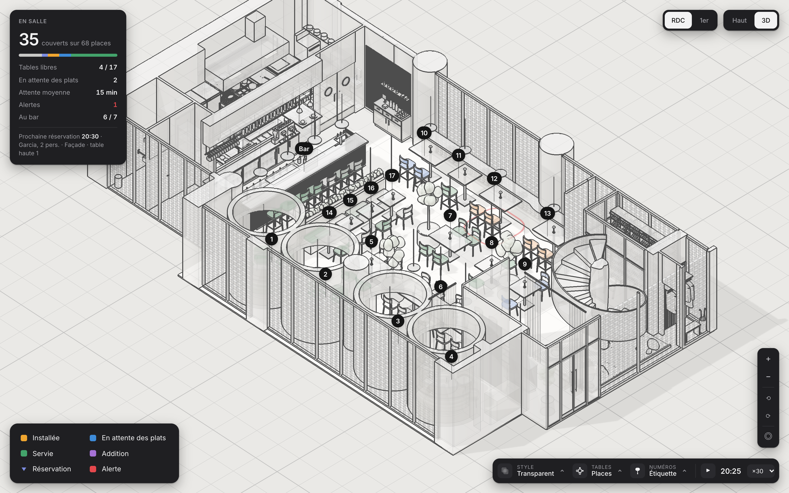
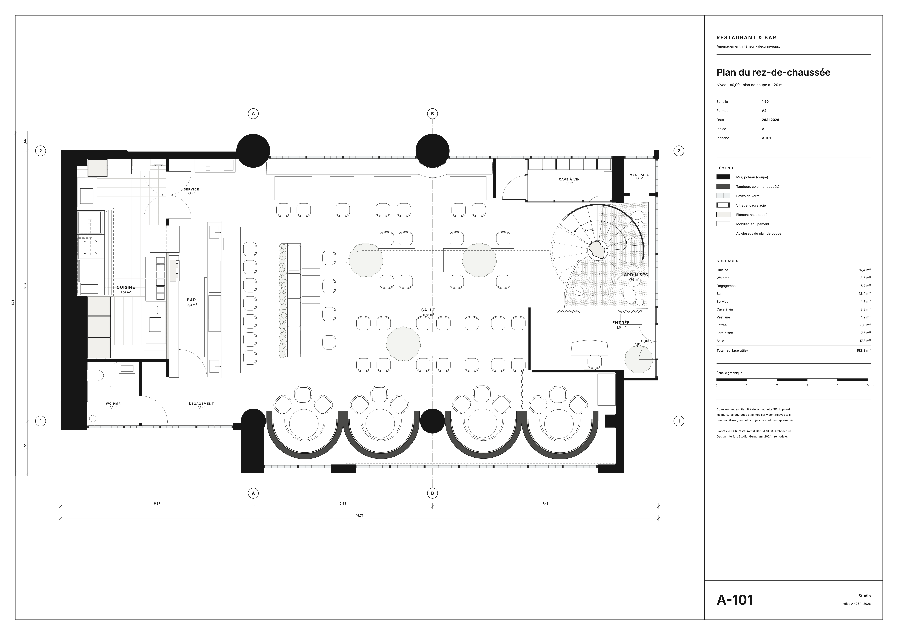

# Restaurant : le plan interactif

Un projet du studio. Les plans d'un restaurant deviennent une carte 3D interactive pour l'équipe de salle : les tables libres et prises, les places occupées, le temps d'attente et les commandes, en direct. Le modèle est construit dans Blender, entièrement par des scripts Python. Aucune scène n'est enregistrée à la main : les scripts sont la source.



Les plans sont ceux du **LAIR Restaurant & Bar** (Gurugram, Inde, 2024), conçu par **RENESA Architecture Design Interiors Studio** et publié sur ArchDaily. Le restaurant de la démo est fictif : son service, ses clients et ses réservations sont simulés.

## Où en est-on

- **Le rez-de-chaussée est terminé.** Il est modélisé à l'échelle réelle, avec la coque, les éléments fixes et le mobilier.
- **La carte interactive** est une application web en three.js. Elle propose :
  - la vue du haut et la vue 3D, avec trois styles : fantôme, transparent et fil de fer ;
  - les états des tables en trois systèmes : places occupées, plateau et minuteur ;
  - les numéros des tables, une légende des six états, une fiche par table et les bars suivis tabouret par tabouret ;
  - un service simulé en accéléré, sur les deux étages ;
  - le changement d'étage : le rez-de-chaussée seul, ou le 1er posé dessus, préchargé pour s'afficher aussitôt.
- **Les plans finaux** des deux étages, tirés du modèle, sont de vrais plans d'architecte (A2 au 1:50, SVG, PNG 300 dpi, PDF). Ils sont dans `rendus/26-plans-finaux/`. Les plans redessinés d'après le client restent dans `rendus/10-plans/`.
- **Le 1er étage** est modélisé : la coque, les éléments fixes, le mobilier, trois colonnes dans le vide et un lierre sur le toit de l'entrée. Il pose sur le rez-de-chaussée : les deux forment un seul bâtiment, dans les rendus comme dans la carte, où le bouton « 1er » montre l'étage sur le bas.



## Ouvrir la carte

Double-cliquer sur `carte/ouvrir-la-carte.command`. On peut aussi servir le dossier `carte/` avec n'importe quel serveur local, par exemple `python3 -m http.server`, puis l'ouvrir dans le navigateur.

## Le dossier

Le guide complet est [`Lis-moi.md`](Lis-moi.md). Il décrit chaque étape, les choix retenus et la façon de refaire chaque rendu.

```
carte/      la carte interactive (three.js, le modèle exporté en glTF, le service simulé)
modele/     les données relevées sur les plans (murs, tables)
outils/     les scripts : Blender (blender/), plans redessinés (plans/), captures, pages des étapes
rendus/     les rendus, étape par étape
pages/      les pages de présentation des étapes
recherche/  les sources : liens et notes
```

Il faut Blender 4.5, Python 3 avec numpy, OpenCV et Pillow (plus scikit-image, fonttools et potrace pour les copies des plans d'origine), et Node avec Playwright pour les captures.

## Ce qui n'est pas dans le dépôt

- **Les plans d'origine, les axonométries et la vidéo de l'architecte**, ainsi que leurs copies en 4K (`rendus/11-plans-d-origine/`) : ce sont des documents de RENESA.
- **Les photos d'ArchDaily** (© Avesh Gaur), et les pages des étapes qui les montrent.
- **Les images de recherche** (Pinterest et le web) : les fichiers `sources.json` gardent leurs liens.
- **Les polices extraites de macOS** et les scènes `.blend` : les scripts les régénèrent.
- **Le modèle de lierre d'origine**, « Ivy for walls » par [arca_done](https://sketchfab.com/arca_done) ([Sketchfab](https://sketchfab.com/3d-models/ivy-for-walls-b5e66f95a4de4cc19e68596f489eeaac), licence [CC BY 4.0](http://creativecommons.org/licenses/by/4.0/)) : le lierre du 1er est remodélisé d'après lui.
